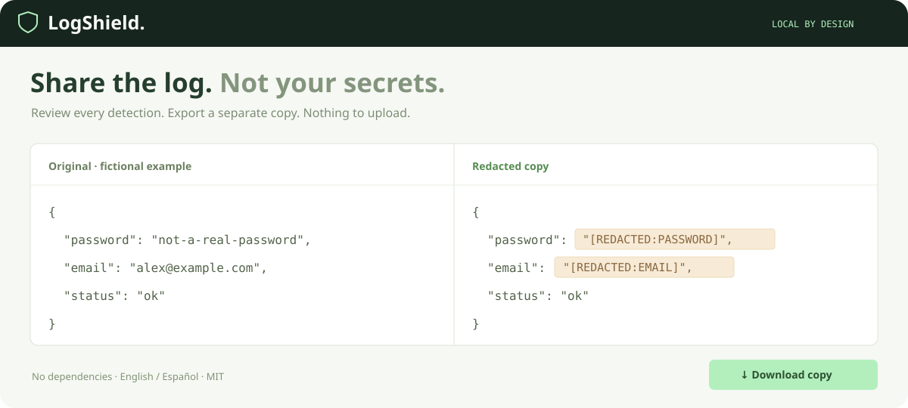

# LogShield

### Share the log. Not your secrets.

Review and redact credentials from text and JSON **locally in your browser**. No uploads, accounts, dependencies, or build step.

[Live demo](https://0xsixtos.github.io/logshield/) · [Español](README.es.md) · [Getting started](#run-locally) · [Detection rules](#what-it-detects) · [Privacy](#privacy-and-limits) · [Contributing](CONTRIBUTING.md)



## Why LogShield?

Logs are useful. Accidentally sharing a bearer token, password, or customer email is not.

LogShield makes each replacement visible and reversible before export. It produces a separate copy and does not overwrite your input file. It runs without an AI provider, API key, database, or analytics SDK.

## Run locally

You need Node.js 20 or later. No package installation is necessary.

```sh
git clone https://github.com/0xSixtos/logshield.git
cd logshield
npm start
```

Open **http://127.0.0.1:4317**. Or serve `dist/` with any static HTTP server. Opening `index.html` with `file://` is not supported because the app uses ES modules and a Web Worker.

1. Try the fictional sample or open a UTF-8 text file (`.txt`, `.log`, `.env`, `.json`).
2. Select **Analyze text**. `Ctrl+Enter` / `⌘+Enter` also works.
3. Review the detections. Uncheck a match to leave that value visible; a warning shows how many remain visible.
4. Download or copy the redacted output. Optionally download a summary containing categories and positions, without matched values or the input filename.

**English and Spanish are built in.** Choose EN / ES in the navigation. Files are limited to 2 MB.

## What it detects

| Category | Examples |
| --- | --- |
| Named credentials | `password`, `api_key`, `client_secret`, `access_token`, `refresh_token`, `session_id` |
| Authorization | Bearer / Basic authorization headers |
| Cookies | Named cookie fields and complete plain-text cookie headers |
| Recognizable token shapes | Common GitHub, AWS access-key ID, OpenAI-style key prefixes, JWT-shaped strings |
| Private keys | PEM / OpenSSH private-key blocks and named `private_key` fields |
| URLs | Embedded `user:password@host` credentials and named sensitive query values |
| Personal data | Common email addresses; optional IPv4 detection |

The current exact field-name rules live in [`dist/detector.js`](dist/detector.js). Matching is heuristic: **the app does not verify whether any detected value is a real or active credential**.

### JSON handling

For valid JSON objects and arrays, the detector uses token positions in the original text. It retains indentation, non-sensitive values, and duplicate-key positions. A sensitive value that is not a string is replaced with a JSON string so the output remains parseable.

JSON-looking input that cannot be parsed is labeled and treated as plain text. Extremely deep JSON is rejected rather than returning a partial success. If the detection limit is reached, the UI blocks export and asks you to split the input.

## Privacy and limits

- File content is processed in memory in a Web Worker and rendered in the current tab.
- The app has no upload endpoint, analytics, cookies, local storage, or saved history.
- `connect-src 'none'` blocks application-initiated outbound connections. Opening a hosted copy still requires downloading its static assets; the hosting service may keep ordinary access logs. Clipboard and downloads occur only when you request them.
- **Clear** removes the current input and result from the interface. This is not a guarantee of forensic memory erasure by JavaScript or the browser.
- Pattern detection can miss arbitrary secrets, unusual field names, encoded/escaped personal data, nonstandard token formats, binary files, and secrets inside unsupported formats. It can also flag harmless text.
- Phone numbers, payment-card checks, HAR-specific semantics, OCR, and repository-wide scanning are not included in v0.1.
- A file containing HTML is displayed as text. Log content is never inserted as HTML.
- Review every output before sharing. This is a review aid, not a guarantee that an artifact is safe to publish. Rotate a credential if you have already exposed it.

## Tests

```sh
npm test
```

Tests cover JSON validity, escaped values, duplicate keys, overlapping matches, explicit opt-outs, UTF-8 limits, truncation, and preservation of non-sensitive data. They use fictional fixtures only. Browser QA also covers stale-result blocking, manual review, language switching, literal HTML rendering, clearing input, and a downloaded JSON copy.

## Project layout

```text
dist/
  index.html       Accessible interface
  style.css        Responsive visual design
  app.js           UI state, review, clipboard, downloads, EN / ES
  detector.js      Pure detection and redaction functions
  worker.js        Background analysis
scripts/serve.mjs  Small loopback-only development server
test/             Node's built-in test runner
```

## Contribute

Good first contributions: add a fictional regression fixture for a missed pattern, improve keyboard accessibility, or improve translations. See [CONTRIBUTING.md](CONTRIBUTING.md). Please never paste real credentials or personal logs into an issue.

## License

[MIT](LICENSE) · Built by [0xSixtos](https://github.com/0xSixtos).
